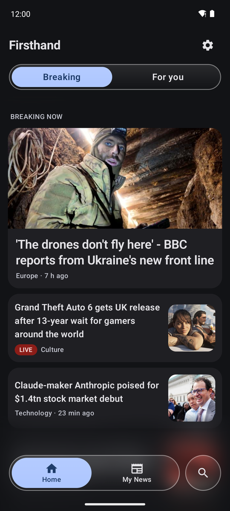
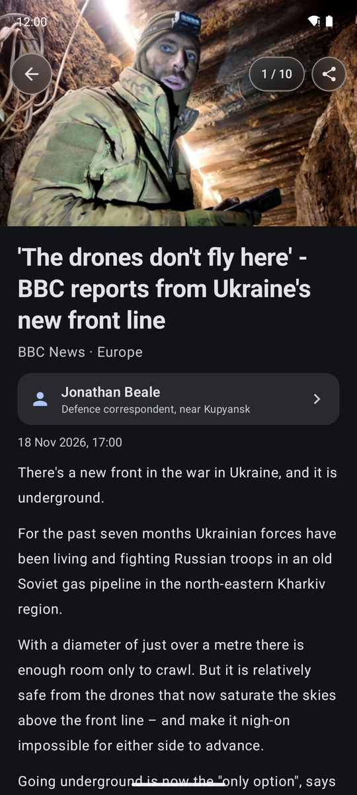
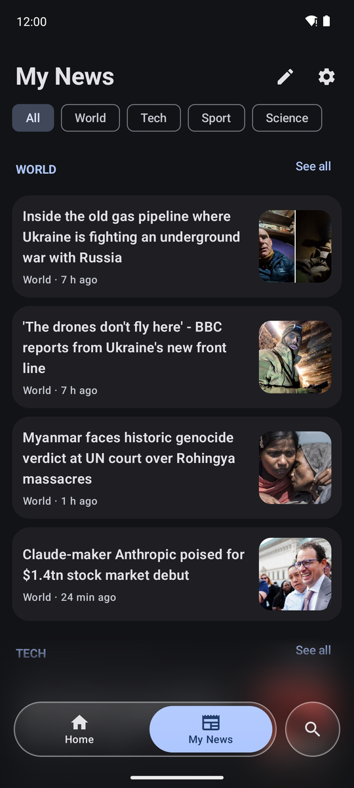
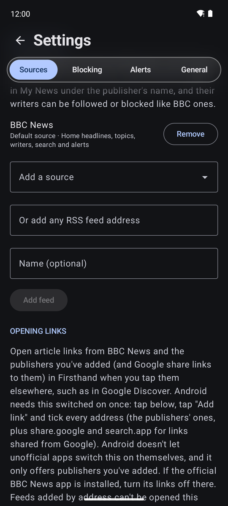
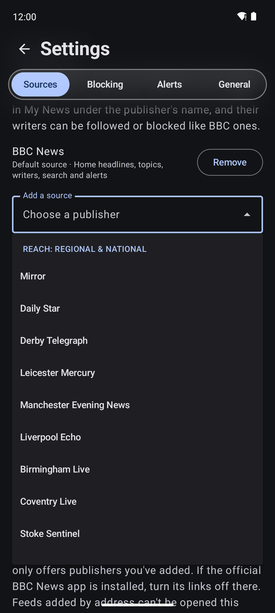
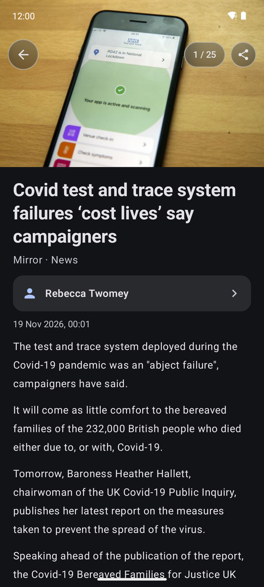

# Firsthand

A private, sideloaded Android news reader that pulls from the sources you choose, built with Kotlin, Jetpack Compose and Material You. There is no account and no server: the app fetches everything itself, straight from the publishers.

**Unofficial.** Firsthand is not affiliated with, endorsed by or sponsored by any publisher. It uses its own icon, ships no publisher logos, and is never published. Content is fetched from the public feeds and pages of the sources you add, for personal use only.

## Screenshots
<!-- screenshots:start -->
<table>
<tr><td align="center"> Home</td><td align="center"> Reader</td><td align="center"> My News</td><td align="center"> Your sources</td></tr>
<tr><td align="center"> Add a source</td><td align="center"> A local paper's stories</td><td align="center"> Writers and share</td></tr>
</table>
<!-- screenshots:end -->

## Features
- **News sources.** Pick your own: a built-in list (regional and national UK papers such as the Reach titles, Guardian, Sky News, Independent, Mail and Metro, plus world and tech sources) or any RSS/Atom feed address you paste in. Add and remove them in **Settings > News sources**; each source's sections appear in *My News* under its name. Every story card shows its source as a pill ("BBC News", "Example Post"), with its section and age, plus BREAKING or LIVE pills when a source flags them.
- **BBC News is the default source.** A fresh install starts with it added. Remove it like any other source and nothing from it is shown or loaded (Home becomes a "For you" page built from your other sources, and its links go to your browser). It sits first in the *Add a source* list under *Default sources*; adding it back restores your topics.
- **Reader.** A native reader for articles, with live pages and in-app video where a source provides them. Pages that can't be read as text fall back to the story's summary and an *Open original* button. Live pages show their posts natively as text and pictures (no embedded website), refreshing every 30 seconds.
- **Select, share and block from the reader.** Press and hold to select text in an article, live page or video page and adjust the handles as usual; the menu offers Copy, Select all, Share and **Block keyword** (choose Subject or Story scope, then it's added to *Settings > Blocked keywords*). A Share button beside the story counter shares the headline and link. Note that Share and Block keyword pass the selection through the clipboard, so it replaces whatever you last copied.
- **Writers.** Credited writers are tappable: open their page, follow them, or block them (their articles, including co-written ones, are hidden everywhere and from alerts). For most sources a writer's page lists their stories from the feeds you follow.
- **Blocked keywords.** Hide stories about something you don't want to see, in **Settings > Blocked keywords**, with a scope per keyword:
  - *Subject* matches the headline or the story's topic tags, i.e. what the story is about. Blocking "Justin Bieber" hides a story about him, but not one that only mentions him in passing in its summary.
  - *Story* matches anywhere in the headline, summary or tags, even in passing.

  Matching is whole-word and ignores case ("Bieber" won't hide "Bieberstein"). Blocked stories are hidden in every list, search, and from alerts.
- **Follows.** Topics, sections, writers and keywords appear in *My News* and *For you*.
- **Opens links from your sources.** Tap one of your sources' articles in Google Discover, a browser or another app and it opens in Firsthand's reader (see *Opening links in the app*). *Share > Firsthand* works too.
- **Search** across what's loaded (and live search where a source supports it), and **breaking-news alerts** with pictures (see *Alerts*).
- **Tidy settings.** Settings are grouped into four glass tabs, like Home: *Sources* (your sources and link opening), *Blocking* (writers and keywords), *Alerts*, and *General* (theme, accent colour, updates, backup, about).
- **Backup.** Export/import your settings (`firsthand-settings.json`: sources, follows, blocked writers and keywords, theme), and in-app updates from GitHub Releases.

## How it gets the news
- **RSS is the backbone.** Every added source is an RSS (or Atom) feed. Each story's headline, summary, picture, time, topic tags and credited writers come from the feed. The Reach titles serve any section as a feed by adding `?service=rss` to the section's address, which is how their sections are listed. Where a feed includes the full article text it is used directly; otherwise the story's page is fetched when you open it and the article text is read from it. There are no per-site rules, so unusual layouts may fall back to the summary.
- **The default source** (BBC News) uses its public RSS feeds for sections and topics, plus the data embedded in its web pages for the headline lists, articles, live pages and videos, and its search for keywords and writer pages.
- Everything fetched is cached on the phone so it still opens offline.

## Alerts
Breaking-news alerts come from the default source only, and are rich: they show the story's picture (large when expanded, a thumbnail when collapsed). If a story has no picture of its own, the alert uses the page's preview image, or a generic "Breaking news" card drawn by the app, so an alert is never text-only.

Without a server to push them, the app checks on a schedule. It arms an Android alarm that is allowed to fire while the phone is idle, then runs an expedited background check; WorkManager's periodic job stays as a backup, and a reboot or app update re-arms the alarm. This does not need battery optimisation turned off, but Android can still hold a check back a few minutes while the phone sleeps: setting the app's battery use to *Unrestricted* is the most prompt, and truly instant delivery would need a push server.

## Opening links in the app
Article links from every source you've added open in Firsthand's native reader. Google share links (`share.google`, `search.app`) are followed first and kept only if they lead to one of your sources. Home and section pages, and anything else, still open in your browser. You can also Share any such link to Firsthand.

Android 12+ never auto-routes unverified web links to an app, and Android can't be told about new domains while an app is running, so this works in two steps:
1. The app declares each built-in source's domains in its manifest as a *disabled* alias, and enables the alias when you add that source (and disables it when you remove it). That is what makes the source appear in Android's list. After you add a source the app offers to take you to the right screen.
2. You switch it on once: **Settings > Opening links > Open link settings** (or system Settings > Apps > Firsthand > Open by default), turn on *Open supported links*, tap *Add link* and tick the addresses. If another app from the same publisher is installed, turn off its links there.

Feeds added **by address** can't be picked up automatically (their domain isn't known when the app is built), but sharing one of their articles to Firsthand opens it in the reader.

## Updates
**Settings > Updates** checks this repo's latest GitHub Release, downloads the APK, verifies its SHA-256 and installs it over the current app (Android's package installer; it asks once to allow "Install unknown apps"). The repository must be public for this to work (no token is stored).

### Releasing
1. Add four repository secrets (Settings > Secrets and variables > Actions): `KEYSTORE_B64` (base64 of the keystore), `KEYSTORE_PASSWORD`, `KEY_ALIAS`, `KEY_PASSWORD`. A stable key is required: Android refuses an update signed with a different key than the installed app. Without the secrets builds fall back to the debug key and are published only as pre-releases (never offered by the updater).
2. Actions > *Build APK* > Run workflow > tick **release**. It builds, tests, signs and publishes release `v0.1.<build number>` with `firsthand-0.1.<build number>.apk`. The build number is the CI run number plus a fixed offset and becomes the app's `versionCode`, so every build is a new patch version.

Every push also runs the unit tests and builds an APK artifact. The **Screenshots** workflow (run by hand from the Actions tab, dark or light) boots an Android emulator, tours the main screens, commits the pictures to `docs/screenshots/` and refreshes the section at the top of this README. Keep the keystore safe and out of the repo: losing it means reinstalling once.

## Licence and FOSS compliance
GPL-3.0-or-later (see `LICENSE`). Every dependency is FOSS (AndroidX, Kotlin, kotlinx.serialization, OkHttp, Coil, Haze: Apache-2.0; jsoup: MIT). No Google Play Services, analytics, ads, crash reporters or proprietary binaries; the APK embeds no dependency-info blob. Publishers' content is not covered by this licence and is not bundled.
